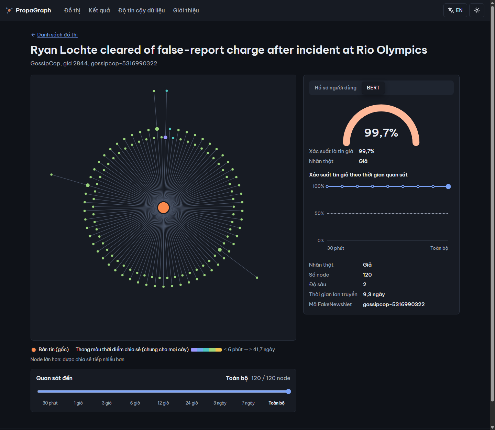
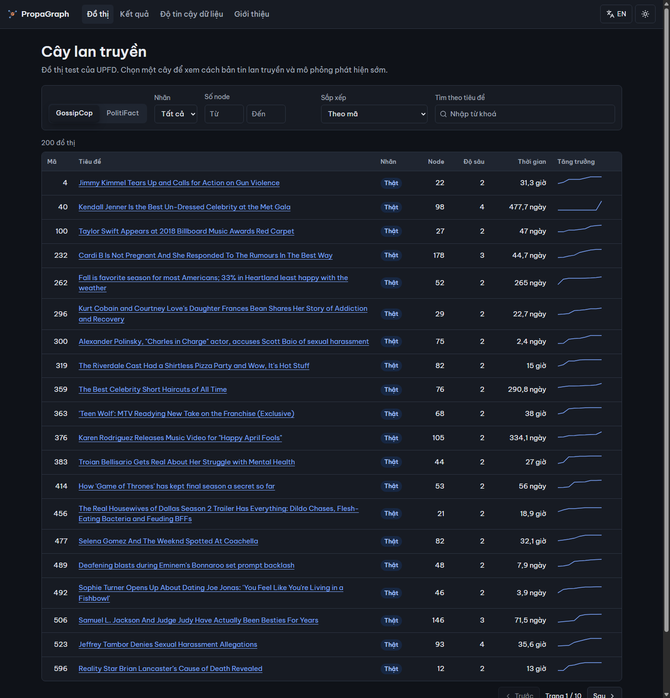

# PropaGraph – Phát hiện tin giả dựa trên đồ thị lan truyền

> Đồ án chuyên ngành 2 · Lớp 23GITB · GVHD: PGS.TS. Nguyễn Thanh Bình
> Nhóm: Trần Thị Thùy Dương · Lê Thái Lâm · Phạm Lan Nhi

PropaGraph là **hệ thống minh họa** cho đề tài *"Phát hiện tin giả dựa trên đồ thị lan truyền
bằng mạng nơ-ron đồ thị"*. Hệ thống cho phép xem cách một bản tin lan truyền trên Twitter dưới
dạng cây, xem mô hình GNN đánh giá bản tin đó là thật hay giả, và **mô phỏng phát hiện sớm**:
mô hình chỉ được nhìn phần cây xuất hiện trong vài giờ đầu.



---

## Bài toán và cách tiếp cận

Mỗi bản tin trong bộ dữ liệu **UPFD** (PolitiFact và GossipCop) được biểu diễn thành một cây
lan truyền: nút gốc là bản tin, các nút còn lại là người dùng đã chia sẻ lại, cạnh nối người
chia sẻ với nguồn họ chia sẻ từ đó. Mỗi nút mang một vector đặc trưng. Hệ thống dùng hai loại:

- `profile`: 10 đặc trưng hồ sơ người dùng.
- `bert`: biểu diễn 768 chiều từ lịch sử bài đăng của người dùng.

Bài toán là **phân loại đồ thị**: cả cây được gán nhãn *thật* hoặc *giả*.

Phần thực nghiệm (thực hiện trong notebook trên Google Colab) so sánh bốn kiến trúc GNN (GCN, GAT,
GraphSAGE, GIN) với các baseline không dùng đồ thị, và gồm các thí nghiệm:

| Mã | Nội dung |
| --- | --- |
| E0 | So sánh 4 GNN × các loại đặc trưng, so với baseline |
| E1 | Ablation cấu trúc cạnh (cây thật, hình sao, cây ngẫu nhiên, không cạnh) |
| E2 | Vai trò của đặc trưng nút gốc |
| E3 | Phát hiện sớm: cắt cây theo thời gian quan sát |
| E4 | Biến thể cải tiến GNN+ (thêm đặc trưng cấu trúc và động học) |
| E5 | Stratified k-fold trên PolitiFact |
| E6 | Kiểm định bootstrap và phân tích lỗi |

Với mỗi cặp *bộ dữ liệu × loại đặc trưng*, hệ thống dùng mô hình có F1 trung bình cao nhất ở E0.
Số liệu cụ thể của từng thí nghiệm hiển thị trên trang **Kết quả** của hệ thống, đọc trực tiếp
từ các bảng do notebook xuất ra, và trình bày trong báo cáo đồ án. README không chép lại số liệu
để tránh lệch với nguồn.

## Hệ thống làm gì

| Trang | Nội dung |
| --- | --- |
| **Đồ thị** | Danh sách 200 cây lan truyền test mỗi bộ dữ liệu (cân bằng nhãn); lọc theo nhãn, số nút, tìm theo tiêu đề |
| **Chi tiết cây** | Cây dạng radial (màu theo thời điểm chia sẻ, kích thước theo số lượt chia sẻ tiếp); xác suất tin giả; chọn đặc trưng `profile` / `bert` |
| **Phát hiện sớm** | Thanh thời gian 30 phút → 1 giờ → … → 7 ngày → toàn bộ. Cây và xác suất cập nhật theo phần cây đã quan sát; đường xác suất theo thời gian |
| **Kết quả** | Bảng và biểu đồ E0–E6, hiển thị nguyên văn như notebook xuất |
| **Độ tin cậy dữ liệu** | Những điểm cần biết về UPFD trước khi đọc kết quả: quy ước nhãn, thứ tự nút ≠ thứ tự thời gian, nhiễu thời gian ở PolitiFact, tiêu đề trùng… |



**Phát hiện sớm hoạt động thế nào.** Với mốc *t* giờ, hệ thống giữ nút gốc và những người dùng
chia sẻ trong *t* giờ đầu (tính từ lượt chia sẻ đầu tiên). Người dùng nào có nút cha chưa xuất
hiện thì được nối thẳng vào nút gốc. Cây sau khi cắt được chuyển thành đồ thị vô hướng rồi đưa
vào mô hình. Quy tắc này giống hệt notebook; một bộ kiểm thử tự động (*parity test*) so xác suất
của hệ thống với xác suất notebook tính sẵn, sai số cho phép ≤ 10⁻⁴.

## Phạm vi và lưu ý

- Hệ thống **chỉ suy luận** trên các đồ thị test có sẵn của UPFD. Không huấn luyện lại mô hình.
- **Không nhận URL hay văn bản tin tức mới.** UPFD không công bố văn bản gốc, và đặc trưng người
  dùng được tính từ lịch sử tweet không còn thu thập lại được.
- **Không phải công cụ kiểm chứng thông tin.** Mọi trang đều ghi: *"Hệ thống minh họa cho đồ án
  học thuật, chỉ chạy trên dữ liệu UPFD đã công bố. Kết quả không phải là kết luận kiểm chứng
  thông tin."*

## Kiến trúc

```text
Notebook (Colab)  ──xuất──►  artifacts/  ──nạp một lần──►  Backend (FastAPI, PyTorch Geometric, CPU)
huấn luyện, E0–E6            model, đồ thị,                       │ REST /api/*
                             bảng, hình                           ▼
                                                           Frontend (React + TypeScript, Vite)
```

- **Backend** nạp mô hình và dữ liệu một lần khi khởi động, cắt cây theo thời gian, chạy suy luận
  và phục vụ bảng kết quả. API mô tả ở [`docs/api.md`](docs/api.md); khi chạy, xem tài liệu tương
  tác tại `http://localhost:8000/docs`.
- **Frontend** chỉ gọi API, không chứa số liệu viết tay. Tiếng Việt mặc định, có tiếng Anh và
  chế độ tối.
- Chi tiết: [`docs/architecture.md`](docs/architecture.md).

## Chạy thử trên máy

**Cần:** Python 3.11, Node.js 22, Git. Máy chỉ cần CPU, không cần GPU.

**Dữ liệu (`artifacts/`) không nằm trong repo.** Đây là mô hình đã huấn luyện, đồ thị demo và
bảng kết quả do notebook xuất ra. Thầy cô hoặc người cần chạy với dữ liệu thật vui lòng liên hệ
nhóm để nhận thư mục này; cách đặt thư mục ở [`scripts/fetch_artifacts.md`](scripts/fetch_artifacts.md).
Chưa có artifacts vẫn xem được giao diện bằng **dữ liệu giả** (bước 2b), khi đó giao diện hiện
cảnh báo "dữ liệu giả".

```bash
# 1. Cài đặt lần đầu: môi trường ảo .venv, thư viện backend, thư viện frontend
python scripts/run.py setup
#    PyTorch và PyTorch Geometric bản CPU, đúng phiên bản mô hình yêu cầu
.venv/Scripts/python -m pip install torch==2.14.1 --index-url https://download.pytorch.org/whl/cpu   # Linux/macOS: .venv/bin/python
.venv/Scripts/python -m pip install -e "backend[ml]"

# 2a. Có artifacts: đặt vào ./artifacts rồi kiểm tra đủ file, đúng phiên bản
python scripts/check_artifacts.py
# 2b. Chưa có artifacts: sinh dữ liệu giả, rồi thêm ARTIFACTS_DIR=.cache/dev-artifacts vào .env
python scripts/run.py devdata

# 3. Chạy (hai cửa sổ terminal)
python scripts/run.py dev          # backend  http://localhost:8000
cd frontend && npm run dev         # frontend http://localhost:5173
```

Đăng nhập bằng tài khoản thử ở [`docs/accounts.md`](docs/accounts.md). Có thể chạy bằng Docker
(`docker compose up --build`, giao diện ở `http://localhost:8080`); cấu hình Docker đã có nhưng
chưa được kiểm thử đầy đủ với PyTorch.

**Kiểm thử:**

```bash
python scripts/run.py test         # pytest backend, gồm parity test (tự bỏ qua nếu thiếu artifacts)
python scripts/run.py lint         # ruff, black, eslint, prettier
```

## Cấu trúc repo

```text
backend/        API FastAPI: nạp artifacts, cắt cây theo thời gian, suy luận, bảng kết quả, test
frontend/       Giao diện React + TypeScript (Vite)
scripts/        Cài đặt, chạy, kiểm tra artifacts, sinh dữ liệu giả
docs/           API, kiến trúc, tài khoản thử, đặc tả và kế hoạch phát triển
artifacts/      (không có trong repo) mô hình và dữ liệu do notebook xuất ra
notebooks/      (không có trong repo) notebook huấn luyện và thực nghiệm, chạy trên Colab
```

Notebook huấn luyện và thực nghiệm được nhóm giữ riêng, không công bố trong repo này.

## Tài liệu

| Tài liệu | Nội dung |
| --- | --- |
| [`docs/architecture.md`](docs/architecture.md) | Kiến trúc và luồng dữ liệu |
| [`docs/api.md`](docs/api.md) | Danh sách endpoint, mã lỗi, định dạng dữ liệu |
| [`docs/accounts.md`](docs/accounts.md) | Tài khoản thử và phân quyền |
| [`DATA_BOUNDARY.md`](DATA_BOUNDARY.md) | Ranh giới dữ liệu: số liệu nào được hiển thị, lấy từ đâu |
| [`docs/development.md`](docs/development.md) | Đặc tả chi tiết, kế hoạch và tiến độ (tài liệu nội bộ của nhóm) |
| [`BACKLOG.md`](BACKLOG.md) | Danh sách công việc |
| [`CONTRIBUTING.md`](CONTRIBUTING.md) | Quy ước nhánh, commit, pull request |

## Nguồn dữ liệu và trích dẫn

- **UPFD:** Y. Dou, K. Shu, C. Xia, P. S. Yu, L. Sun. *User Preference-aware Fake News
  Detection*. SIGIR 2021. [github.com/safe-graph/GNN-FakeNews](https://github.com/safe-graph/GNN-FakeNews)
- **FakeNewsNet:** K. Shu, D. Mahudeswaran, S. Wang, D. Lee, H. Liu. *FakeNewsNet: A Data
  Repository with News Content, Social Context, and Spatiotemporal Information for Studying Fake
  News on Social Media*. Big Data, 2020. [github.com/KaiDMML/FakeNewsNet](https://github.com/KaiDMML/FakeNewsNet)
- **PyTorch Geometric:** `torch_geometric.datasets.UPFD`.
